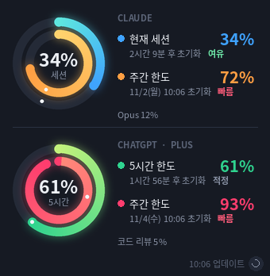
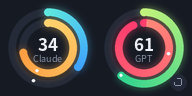
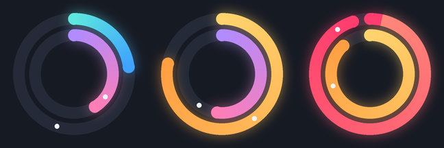

<div align="center">

# AI 사용량 위젯

**Claude · ChatGPT(Codex) 사용량을 바탕화면과 아이폰에서 한눈에**

사용량 페이지에 매번 들어가지 않아도, 화면 구석의 링 게이지로<br>
지금 얼마나 썼는지, 언제 초기화되는지, 이 속도면 괜찮은지 바로 확인할 수 있어요.


<table>
  <tr>
    <td align="center"></td>
    <td align="center"></td>
  </tr>
  <tr>
    <td align="center"><sub>자세히 보기</sub></td>
    <td align="center"><sub>미니 모드 (더블클릭으로 전환)</sub></td>
  </tr>
</table>

</div>

> [!WARNING]
> Anthropic·OpenAI의 공식 앱이 아니에요. 각 사이트의 사용량 페이지가 내부적으로 쓰는 주소를 불러오는 방식이라
> 사이트 구조가 바뀌면 갑자기 작동하지 않을 수 있어요. 세션 키·토큰은 **로그인 정보와 같으니** 절대 공유하지 마세요.

## 목차

- [주요 기능](#주요-기능)
- [빠른 시작 (Windows)](#빠른-시작-windows)
- [데스크톱 위젯 설치](#데스크톱-위젯-설치)
- [아이폰 위젯 (Scriptable)](#아이폰-위젯-scriptable)
- [사용법](#사용법)
- [화면 읽는 법](#화면-읽는-법)
- [문제 해결](#문제-해결)
- [설정 파일과 삭제](#설정-파일과-삭제)
- [폴더 구조](#폴더-구조)
- [알려진 한계](#알려진-한계)

## 주요 기능

| 기능 | 설명 |
|---|---|
| **두 서비스를 한 화면에** | Claude(5시간 세션·주간 한도)와 ChatGPT(Codex 5시간·주간 한도)를 위아래로 함께 표시. 하나만 켤 수도 있어요 |
| **네온 링 게이지** | 애플워치 활동 링 스타일. 70% 넘으면 주황, 90% 넘으면 빨강으로 바뀌어요 |
| **사용 속도 표시** | 링 위의 흰 점 = 초기화 주기 중 흐른 시간. 시간 대비 *여유 / 적정 / 빠름* 을 알려 줘요 |
| **미니 모드** | 더블클릭 한 번으로 링만 남는 작은 창으로 |
| **자동 새로고침** | 2분마다 자동 갱신, ↻ 버튼으로 즉시 갱신 |
| **Codex 자동 연결** | 이 PC에서 Codex에 로그인해 두었다면 ChatGPT는 따로 설정할 필요 없음 |
| **아이폰 위젯** | 홈 화면(작게·중간·크게)과 잠금 화면 위젯 지원 (Claude만) |

## 빠른 시작 (Windows)

```bash
pip install pillow curl_cffi
```

1. [`desktop/claude_usage_widget.pyw`](desktop/claude_usage_widget.pyw)를 받아서 더블클릭
2. Claude 세션 키 붙여넣기 → [세션 키 복사하는 법](#2-claude-세션-키-복사)
3. ChatGPT: Codex에 로그인돼 있으면 자동 연결, 아니면 [쿠키 값](#3-chatgpt-연결-선택) 붙여넣기 (안 쓰면 취소)
4. 끝! 컴퓨터 켤 때 자동으로 띄우려면 [자동 실행](#5-컴퓨터-켤-때-자동-실행) 참고

---

## 데스크톱 위젯 설치

> [!TIP]
> **파일 받는 법** — Git을 몰라도 괜찮아요.
> - 파일 하나만: [`desktop/claude_usage_widget.pyw`](desktop/claude_usage_widget.pyw)를 열고 오른쪽 위 **⤓ (Download raw file)** 버튼
> - 전체: 이 페이지 위쪽 초록색 **Code** 버튼 → **Download ZIP** → 압축 풀기

### 1. 파이썬과 패키지 설치

1. [python.org](https://www.python.org/downloads/)에서 파이썬을 설치해요.
   - **Windows**: 설치 첫 화면에서 **"Add python.exe to PATH"** 를 꼭 체크하세요.
2. cmd(Windows) 또는 터미널(Mac)에서 패키지를 설치해요.

   ```bash
   pip install pillow curl_cffi
   ```

   - Mac은 `pip` 대신 `pip3`를 쓰세요.
   - Mac에서 Homebrew로 파이썬을 설치했다면 이것도 필요해요: `brew install python-tk`

| 패키지 | 용도 |
|---|---|
| `pillow` | 링 게이지 그리기 — **필수** |
| `curl_cffi` | 사이트의 자동 요청 차단 피하기 — ChatGPT는 사실상 필수 |

### 2. Claude 세션 키 복사

1. PC 브라우저에서 [claude.ai](https://claude.ai)에 로그인
2. 개발자 도구 열기 — `F12` (Mac: `Cmd + Option + I`)
3. 쿠키 찾기
   - **크롬·엣지**: Application 탭 → Cookies → `https://claude.ai`
   - **사파리**: 저장 공간 탭 → 쿠키 → `claude.ai`
     <sub>(개발자 도구가 안 열리면 사파리 설정 → 고급 → "웹 개발자용 기능 보기"를 켜세요)</sub>
4. 이름이 **`sessionKey`** 인 항목의 값을 복사 (`sk-ant-sid01-` 로 시작해요)

### 3. ChatGPT 연결 (선택)

> [!NOTE]
> ChatGPT 쪽은 [chatgpt.com/codex/settings/usage](https://chatgpt.com/codex/settings/usage)에 나오는 **Codex 사용 한도**예요.
> 일반 ChatGPT 채팅의 메시지 한도는 OpenAI가 퍼센트로 공개하지 않아서 가져올 수 없어요.

둘 중 편한 방법 하나만 하면 돼요.

**방법 A — Codex를 쓰고 있다면 (가장 간편)**
이 컴퓨터에서 Codex(CLI·VS Code 확장·앱)에 ChatGPT 계정으로 로그인해 두었다면 **자동으로 연결**돼요. 할 일이 없어요.
(`~/.codex/auth.json`을 읽기만 하고 절대 수정하지 않아요.)

**방법 B — 브라우저 쿠키 복사**
1. PC 브라우저에서 [chatgpt.com](https://chatgpt.com)에 로그인
2. `F12` → Application 탭 → Cookies → `https://chatgpt.com`
3. 이름이 **`__Secure-next-auth.session-token`** 인 항목의 값을 복사
   - 이름 끝에 `.0` / `.1` 이 붙어 두 개로 나뉘어 있으면, `.0` 값 바로 뒤에 `.1` 값을 이어 붙여 주세요.

### 4. 실행

**Windows** — `claude_usage_widget.pyw`를 더블클릭하면 cmd 창 없이 위젯만 떠요.

```bat
:: cmd에서 실행하려면 ("pythonw"를 못 찾으면 pyw 로 바꿔서 입력)
pythonw claude_usage_widget.pyw
```

**Mac** — 터미널에서 파일이 있는 폴더로 이동한 뒤:

```bash
nohup python3 claude_usage_widget.pyw >/dev/null 2>&1 &
```

이후 터미널을 닫아도 위젯은 계속 떠 있어요.

처음 실행하면 Claude 세션 키와 ChatGPT 토큰을 차례로 물어봐요. **안 쓰는 쪽은 취소**하면 돼요.

> [!TIP]
> **업데이트**할 때는 새 `.pyw` 파일로 덮어쓰기만 하면 돼요. 창 위치·세션 키 같은 설정은 홈 폴더의 설정 파일에 따로 저장돼 있어서 그대로 이어져요.

### 5. 컴퓨터 켤 때 자동 실행

<details>
<summary><b>Windows</b></summary>

1. `Win + R` → `shell:startup` 입력 → 확인
2. 열린 폴더에 `claude_usage_widget.pyw`의 **바로가기**를 넣기

</details>

<details>
<summary><b>Mac</b></summary>

1. 터미널에서 `which python3` 입력 → 나온 경로 기억
2. **Automator** 실행 → 새로운 문서 → **응용 프로그램**
3. **셸 스크립트 실행**을 끌어다 놓고 아래처럼 입력
   ```bash
   /나온/경로/python3 /위젯/파일/경로/claude_usage_widget.pyw
   ```
4. 응용 프로그램으로 저장
5. 시스템 설정 → 일반 → **로그인 항목**에 방금 만든 앱 추가

</details>

---

## 아이폰 위젯 (Scriptable)

[Scriptable](https://scriptable.app) 앱을 이용한 홈 화면·잠금 화면 위젯이에요. **현재는 Claude 사용량만** 지원해요.

### 설치

1. App Store에서 **Scriptable** 설치 (무료)
2. [`ios/claude_usage_scriptable.js`](ios/claude_usage_scriptable.js) 파일을 열고 **Copy raw file** 버튼(또는 **Raw** 화면에서 전체 선택)으로 내용 전체 복사
3. Scriptable 앱 → 오른쪽 위 **＋** → 붙여넣기 → 위쪽 제목을 `Claude 사용량` 처럼 알아보기 쉽게 바꾸고 완료
4. 방금 만든 스크립트를 눌러 실행 → **세션 키 입력** ([복사하는 법](#2-claude-세션-키-복사))
   - PC에서 복사한 값은 범용 클립보드·AirDrop처럼 **본인 기기끼리만** 옮기세요. 메신저로 보내지 마세요.
   - 세션 키는 아이폰 **키체인**에만 저장돼요.
5. 위젯 추가
   - **홈 화면**: 빈 곳 길게 누르기 → 편집 → 위젯 추가(iOS 17 이하는 왼쪽 위 ＋) → Scriptable → 크기 선택 → 추가된 위젯을 길게 눌러 **위젯 편집** → Script에서 방금 만든 스크립트 선택
   - **잠금 화면**: 잠금 화면 길게 누르기 → 사용자화 → 잠금 화면 → 위젯 영역 → Scriptable 추가 → 같은 방법으로 스크립트 선택

### 위젯 종류

| 위치 | 크기 | 표시 내용 |
|---|---|---|
| 홈 화면 | 작게 · 중간 | 현재 세션 + 주간(전체) 막대 그래프, 초기화까지 남은 시간 |
| 홈 화면 | 크게 | 위 내용 + 주간 Opus / Sonnet 한도(있을 때) |
| 잠금 화면 | 직사각형 | `세션 34% · 2h9m` / `주간 72% · 월 10:06` |
| 잠금 화면 | 한 줄 (시계 위) | `Claude 세션 34% · 주간 72%` |

- 홈 화면 위젯을 누르면 claude.ai 사용량 페이지가 열려요.
- 막대 색: 70% 이상 주황, 90% 이상 빨강
- 스크립트를 앱에서 다시 실행하면 **미리보기 / 세션 키 변경 / 세션 키 삭제** 메뉴가 나와요.
- iOS 정책상 위젯은 보통 **15분 이상 간격**으로만 새로고침돼요.

---

## 사용법

| 동작 | 기능 |
|---|---|
| 드래그 | 창 이동 (위치는 자동 저장) |
| 더블클릭 | 미니 모드 ↔ 자세히 보기 전환 |
| ↻ 버튼 | 두 서비스 모두 지금 새로고침 (미니 모드에서는 마우스를 올리면 나타나요) |
| 우클릭 (Mac: `Control` + 클릭) | 메뉴 열기 |

**우클릭 메뉴**

- 지금 새로고침
- 미니 / 자세히 보기
- 항상 위에 표시 켜기·끄기
- Claude 표시 / ChatGPT 표시 켜기·끄기
- Claude 세션 키 변경
- ChatGPT 연결 설정
- 종료

사용량은 **2분마다** 자동으로 새로고침돼요. 한 서비스에서 오류가 나도 다른 서비스는 정상적으로 표시돼요.

## 화면 읽는 법

<p align="center">
  <br>
  <sub>왼쪽부터 평소 · 70% 이상 · 90% 이상</sub>
</p>

**링 구성**

| 서비스 | 바깥 링 | 안쪽 링 |
|---|---|---|
| Claude | 현재 세션 (5시간) | 주간 한도 |
| ChatGPT | 5시간 한도 | 주간 한도 |

<sub>ChatGPT는 요금제에 따라 주간 한도 링 하나만 나올 수 있어요.</sub>

**링 색깔**

| 상태 | 색 |
|---|---|
| Claude 세션 / 주간 | 청록 → 파랑 / 보라 → 핑크 |
| ChatGPT 5시간 / 주간 | 연두 → 초록 / 하늘 → 남보라 |
| 70% 이상 | 노랑 → 주황 |
| 90% 이상 | 빨강 |

**링 가운데 숫자** — 바깥 링(짧은 주기)의 사용률이에요. 미니 모드에서는 숫자 아래에 `Claude` / `GPT`가 표시돼요.

**링 위의 흰 점** — 리셋 주기 중 지금까지 흐른 시간이에요. **색이 흰 점보다 앞서 있으면** 시간에 비해 빨리 쓰고 있다는 뜻이에요.

**오른쪽 속도 표시** (자세히 보기 모드, 주기가 10% 이상 지난 뒤부터)

| 표시 | 의미 |
|---|---|
| 🟢 여유 | 시간 대비 천천히 쓰는 중 |
| ⚪ 적정 | 시간 흐름과 비슷하게 쓰는 중 |
| 🔴 빠름 | 이대로면 초기화 전에 한도에 닿을 수 있음 |

맨 아래 작은 글씨에는 Opus / Sonnet 별도 한도(Claude), 코드 리뷰 한도(ChatGPT)가 있으면 함께 표시돼요.

---

## 문제 해결

<details>
<summary><b>위젯이 아예 안 떠요</b></summary>

`pythonw`는 오류를 보여주지 않아요. cmd에서 아래처럼 실행해서 오류 메시지를 확인하세요.

```bat
python claude_usage_widget.pyw
```

가장 흔한 원인은 `pip install pillow`를 안 한 경우예요.

</details>

<details>
<summary><b>"Claude 세션 키가 만료됐어요"</b></summary>

세션 키는 몇 주 지나면 만료되고, claude.ai에서 로그아웃해도 만료돼요.
[세션 키 복사](#2-claude-세션-키-복사) 방법으로 새 값을 복사한 뒤 **우클릭 → Claude 세션 키 변경**.

</details>

<details>
<summary><b>"Codex 로그인이 만료됐어요"</b></summary>

cmd/터미널에서 `codex`를 한 번 실행하거나 VS Code의 Codex 확장을 열면 자동으로 갱신돼요.
또는 [방법 B (쿠키)](#3-chatgpt-연결-선택)로 연결하세요.

</details>

<details>
<summary><b>"ChatGPT 세션 토큰이 만료됐어요"</b></summary>

[방법 B](#3-chatgpt-연결-선택)로 새 값을 복사한 뒤 **우클릭 → ChatGPT 연결 설정**.

</details>

<details>
<summary><b>ChatGPT 칸에 "연결 안 됨"</b></summary>

**우클릭 → ChatGPT 연결 설정**으로 토큰을 넣거나, ChatGPT를 안 쓰면 **우클릭 → ChatGPT 표시**를 끄세요.

</details>

<details>
<summary><b>"요청이 차단됐어요"</b></summary>

```bash
pip install curl_cffi
```

설치 후 위젯을 다시 실행하세요. (특히 ChatGPT는 거의 필수예요)

</details>

<details>
<summary><b>창이 멈췄어요 / 응답 없음</b></summary>

작업 관리자(`Ctrl + Shift + Esc`)에서 `pythonw.exe` 또는 `python.exe`를 종료한 뒤 다시 실행하세요.

</details>

<details>
<summary><b>창이 화면 밖으로 사라졌어요</b></summary>

[설정 파일](#설정-파일과-삭제)을 메모장으로 열어 `"x"`, `"y"` 값을 `40`으로 바꾼 뒤 다시 실행하세요.

</details>

---

## 설정 파일과 삭제

### 설정 파일

| OS | 위치 |
|---|---|
| Windows | `C:\Users\사용자이름\.claude_usage_widget.json` |
| Mac | `~/.claude_usage_widget.json` |

- 저장되는 것: Claude 세션 키, ChatGPT 세션 토큰, 창 위치, 미니 모드 여부, 항상 위 여부, 서비스별 표시 여부
- Codex 로그인 정보(`~/.codex/auth.json`)는 읽기만 하고 절대 수정하지 않아요.
- **새로고침 간격**을 바꾸려면 `claude_usage_widget.pyw` 위쪽의 `REFRESH_SEC = 120` 숫자(초)를 수정하세요. 너무 짧으면 차단될 수 있으니 **60 이상**을 권장해요.

> [!CAUTION]
> 설정 파일에는 세션 키·토큰이 그대로 들어 있어요. 다른 사람에게 보내거나 GitHub 등에 올리지 마세요.

### 삭제하기

1. 우클릭 → 종료
2. 위젯 파일 삭제
3. 위 설정 파일 삭제 (세션 키·토큰도 함께 지워져요)
4. 자동 실행을 등록했다면 시작프로그램 바로가기 / 로그인 항목도 삭제
5. 아이폰: 스크립트를 실행해 **세션 키 삭제** → 위젯과 스크립트 삭제

## 폴더 구조

```
llm-usage/
├── desktop/
│   └── claude_usage_widget.pyw     # Windows / Mac 데스크톱 위젯 (Claude + ChatGPT)
├── ios/
│   └── claude_usage_scriptable.js  # 아이폰 Scriptable 위젯 (Claude)
├── docs/
│   ├── images/                     # 스크린샷
│   └── 작업정리.md                  # 개발 과정 기록
├── requirements.txt                # 데스크톱 위젯 필요 패키지
└── README.md
```

개발 과정(막대 그래프 → 네온 링 → 미니 모드 → ChatGPT 추가)은 [docs/작업정리.md](docs/작업정리.md)에 정리돼 있어요.

## 알려진 한계

- 공식 API가 아니라 각 사이트 사용량 페이지의 내부 주소를 쓰는 방식이라, 사이트 구조가 바뀌면 작동이 멈출 수 있어요.
- 세션 키·토큰은 몇 주 지나면 만료되어 다시 입력해야 해요.
- 아이폰 위젯은 아직 Claude만 지원해요.
- 실제 계정 대신 가짜 응답 데이터로 화면·동작을 확인한 상태예요. 이상한 점이 있으면 [이슈](https://github.com/shun1403/llm-usage/issues)로 알려 주세요.
- 정확한 사용량은 언제나 각 사이트에서 확인할 수 있어요.
  - Claude: claude.ai → 설정 → 사용량
  - ChatGPT: [chatgpt.com/codex/settings/usage](https://chatgpt.com/codex/settings/usage)

---

<sub>이 프로젝트는 Anthropic, OpenAI와 관련이 없는 개인 프로젝트입니다. Claude는 Anthropic의, ChatGPT·Codex는 OpenAI의 상표입니다.</sub>
