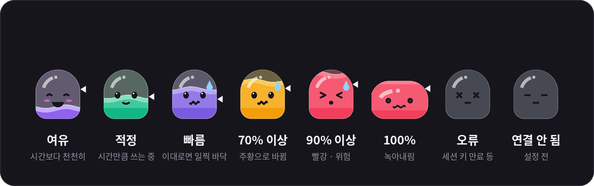

<div align="center">

# AI 사용량 위젯

**Claude와 ChatGPT(Codex) 사용량을 바탕화면과 아이폰에서 한눈에 확인합니다.**


[빠른 시작](#빠른-시작) · [설치](#데스크톱-위젯-설치) · [아이폰 위젯](#아이폰-위젯) · [화면 읽는 법](#화면-읽는-법) · [문제 해결](#문제-해결)

</div>

<br>

사용량 페이지에 매번 들어가지 않아도 됩니다. 화면 구석의 작은 **젤리 친구들**이 몸속 액체 높이로 **지금 얼마나 썼는지**를, 표정으로 **이 속도로 써도 괜찮은지**를 알려 줍니다. 콕 찌르면 통통 튀고, 마우스 커서를 눈으로 따라옵니다.

<p align="center">
  
</p>

> [!WARNING]
> Anthropic·OpenAI의 공식 앱이 아닙니다. 각 사이트의 사용량 페이지가 내부적으로 쓰는 주소를 불러오는 방식이므로,
> 사이트 구조가 바뀌면 갑자기 작동하지 않을 수 있습니다. 세션 키·토큰은 **로그인 정보와 같으니** 절대 공유하지 마십시오.

## 주요 기능

<table>
  <tr>
    <td width="33%" valign="top">
      <b>🫧 젤리 친구들</b><br>
      <sub>서비스마다 젤리 두 마리. 큰 젤리는 5시간 한도, 작은 젤리는 주간 한도이고, 몸속 액체 높이가 사용률입니다.</sub>
    </td>
    <td width="33%" valign="top">
      <b>😊 표정으로 보는 속도</b><br>
      <sub>시간보다 천천히 쓰면 웃고, 빠르면 땀을 흘리고, 90%를 넘으면 찡그리고, 100%가 되면 녹아내립니다.</sub>
    </td>
    <td width="33%" valign="top">
      <b>🎨 한도에 따라 바뀌는 색</b><br>
      <sub>평소에는 Claude 보라, ChatGPT 초록이고, 70%를 넘으면 주황, 90%를 넘으면 빨강으로 바뀝니다.</sub>
    </td>
  </tr>
  <tr>
    <td valign="top">
      <b>👆 살아 있는 반응</b><br>
      <sub>클릭하면 말랑하게 통통 튀고, 마우스 커서 쪽을 바라보며, 가끔 눈을 깜빡입니다.</sub>
    </td>
    <td valign="top">
      <b>🪟 작은 크기</b><br>
      <sub>미니 모드는 216×90, 자세히 보기도 280×254 픽셀. 작업 화면을 거의 가리지 않습니다.</sub>
    </td>
    <td valign="top">
      <b>🌫️ 투명도 조절</b><br>
      <sub>마우스 휠이나 메뉴로 30~100% 사이에서 조절합니다. 마우스를 올리면 잠시 선명해집니다.</sub>
    </td>
  </tr>
  <tr>
    <td valign="top">
      <b>📌 항상 맨 앞</b><br>
      <sub>다른 '항상 위' 창이나 작업 표시줄에 밀려 뒤로 숨지 않도록 2초마다 다시 맨 앞으로 올라옵니다.</sub>
    </td>
    <td valign="top">
      <b>🔌 간편한 연결</b><br>
      <sub>Codex에 로그인해 둔 PC라면 ChatGPT는 자동으로 연결됩니다. 사용량은 2분마다 새로고침됩니다.</sub>
    </td>
    <td valign="top">
      <b>📱 아이폰 위젯</b><br>
      <sub>Scriptable 앱으로 홈 화면(작게·중간·크게)과 잠금 화면에 Claude 사용량을 띄웁니다.</sub>
    </td>
  </tr>
</table>

## 빠른 시작

Windows 기준입니다. 파이썬이 이미 설치되어 있다면 1분이면 충분합니다.

```bash
pip install pillow curl_cffi
```

1. [`desktop/claude_usage_widget.pyw`](desktop/claude_usage_widget.pyw)를 내려받아 더블클릭합니다.
2. Claude 세션 키를 붙여넣습니다. → [세션 키 복사하는 법](#2-claude-세션-키-복사)
3. ChatGPT는 Codex에 로그인되어 있으면 자동으로 연결됩니다. 아니면 [쿠키 값](#3-chatgpt-연결-선택)을 붙여넣고, 쓰지 않으면 취소합니다.
4. 컴퓨터를 켤 때마다 자동으로 띄우려면 [자동 실행](#5-컴퓨터를-켤-때-자동-실행)을 설정합니다.

---

## 데스크톱 위젯 설치

> [!TIP]
> **파일 받는 법** — Git을 몰라도 괜찮습니다.
> - 파일 하나만: [`desktop/claude_usage_widget.pyw`](desktop/claude_usage_widget.pyw)를 열고 오른쪽 위 **⤓ (Download raw file)** 버튼을 누릅니다.
> - 전체: 이 페이지 위쪽의 초록색 **Code** 버튼 → **Download ZIP**을 누른 뒤 압축을 풉니다.

### 1. 파이썬과 패키지 설치

1. [python.org](https://www.python.org/downloads/)에서 파이썬을 설치합니다.
   - **Windows**: 설치 첫 화면에서 **"Add python.exe to PATH"** 를 반드시 체크합니다.
2. cmd(Windows) 또는 터미널(Mac)에서 패키지를 설치합니다.

   ```bash
   pip install pillow curl_cffi
   ```

   - Mac에서는 `pip` 대신 `pip3`를 사용합니다.
   - Mac에서 Homebrew로 파이썬을 설치했다면 `brew install python-tk`도 함께 실행합니다.

| 패키지 | 용도 |
|---|---|
| `pillow` | 젤리 캐릭터 그리기 — **필수** |
| `curl_cffi` | 사이트의 자동 요청 차단 피하기 — ChatGPT는 사실상 필수 |

### 2. Claude 세션 키 복사

1. PC 브라우저에서 [claude.ai](https://claude.ai)에 로그인합니다.
2. 개발자 도구를 엽니다. — `F12` (Mac: `Cmd + Option + I`)
3. 쿠키 목록을 찾습니다.
   - **크롬·엣지**: Application 탭 → Cookies → `https://claude.ai`
   - **사파리**: 저장 공간 탭 → 쿠키 → `claude.ai`
     <sub>(개발자 도구가 열리지 않으면 사파리 설정 → 고급 → "웹 개발자용 기능 보기"를 켭니다.)</sub>
4. 이름이 **`sessionKey`** 인 항목의 값을 복사합니다. (`sk-ant-sid01-` 로 시작합니다.)

### 3. ChatGPT 연결 (선택)

> [!NOTE]
> ChatGPT 쪽 수치는 [chatgpt.com/codex/settings/usage](https://chatgpt.com/codex/settings/usage)에 나오는 **Codex 사용 한도**입니다.
> 일반 ChatGPT 채팅의 메시지 한도는 OpenAI가 퍼센트로 공개하지 않아 가져올 수 없습니다.

아래 두 방법 중 하나만 하면 됩니다.

**방법 A — Codex를 쓰고 있는 경우 (가장 간편)**<br>
이 컴퓨터에서 Codex(CLI·VS Code 확장·앱)에 ChatGPT 계정으로 로그인해 두었다면 **자동으로 연결**됩니다. 따로 할 일은 없습니다.
위젯은 `~/.codex/auth.json`을 읽기만 하며 절대 수정하지 않습니다.

**방법 B — 브라우저 쿠키 복사**
1. PC 브라우저에서 [chatgpt.com](https://chatgpt.com)에 로그인합니다.
2. `F12` → Application 탭 → Cookies → `https://chatgpt.com`을 엽니다.
3. 이름이 **`__Secure-next-auth.session-token`** 인 항목의 값을 복사합니다.
   - 이름 끝에 `.0` / `.1` 이 붙어 두 개로 나뉘어 있다면, `.0` 값 바로 뒤에 `.1` 값을 이어 붙여 주십시오.

### 4. 실행

**Windows** — `claude_usage_widget.pyw`를 더블클릭하면 cmd 창 없이 위젯만 나타납니다.

```bat
:: cmd에서 실행하는 경우 ("pythonw"를 찾지 못하면 pyw로 바꿔 입력합니다)
pythonw claude_usage_widget.pyw
```

**Mac** — 터미널에서 파일이 있는 폴더로 이동한 뒤 실행합니다.

```bash
nohup python3 claude_usage_widget.pyw >/dev/null 2>&1 &
```

이후 터미널을 닫아도 위젯은 계속 떠 있습니다.

처음 실행하면 Claude 세션 키와 ChatGPT 토큰을 차례로 묻습니다. **사용하지 않는 서비스는 취소**하면 됩니다.

> [!TIP]
> **업데이트**할 때는 새 `.pyw` 파일로 덮어쓰기만 하면 됩니다. 창 위치·세션 키 같은 설정은 홈 폴더의 설정 파일에 따로 저장되므로 그대로 유지됩니다.

### 5. 컴퓨터를 켤 때 자동 실행

<details>
<summary><b>Windows</b></summary>

1. `Win + R` → `shell:startup` 입력 → 확인을 누릅니다.
2. 열린 폴더에 `claude_usage_widget.pyw`의 **바로가기**를 넣습니다.

</details>

<details>
<summary><b>Mac</b></summary>

1. 터미널에서 `which python3`를 입력하고, 나온 경로를 기억해 둡니다.
2. **Automator**를 실행한 뒤 새로운 문서 → **응용 프로그램**을 선택합니다.
3. **셸 스크립트 실행**을 끌어다 놓고 아래처럼 입력합니다.
   ```bash
   /나온/경로/python3 /위젯/파일/경로/claude_usage_widget.pyw
   ```
4. 응용 프로그램으로 저장합니다.
5. 시스템 설정 → 일반 → **로그인 항목**에 방금 만든 앱을 추가합니다.

</details>

---

## 아이폰 위젯

[Scriptable](https://scriptable.app) 앱을 이용한 홈 화면·잠금 화면 위젯입니다. **현재는 Claude 사용량만** 지원합니다.

### 설치

1. App Store에서 **Scriptable**을 설치합니다. (무료)
2. [`ios/claude_usage_scriptable.js`](ios/claude_usage_scriptable.js) 파일을 열고 **Copy raw file** 버튼(또는 **Raw** 화면에서 전체 선택)으로 내용 전체를 복사합니다.
3. Scriptable 앱 → 오른쪽 위 **＋** → 붙여넣기를 한 뒤, 위쪽 제목을 `Claude 사용량`처럼 알아보기 쉽게 바꾸고 완료를 누릅니다.
4. 방금 만든 스크립트를 눌러 실행하고 **세션 키를 입력**합니다. ([복사하는 법](#2-claude-세션-키-복사))
   - PC에서 복사한 값은 범용 클립보드·AirDrop처럼 **본인 기기끼리만** 옮기십시오. 메신저로 보내지 마십시오.
   - 세션 키는 아이폰 **키체인**에만 저장됩니다.
5. 위젯을 추가합니다.
   - **홈 화면**: 빈 곳을 길게 누름 → 편집 → 위젯 추가(iOS 17 이하는 왼쪽 위 ＋) → Scriptable → 크기 선택 → 추가된 위젯을 길게 눌러 **위젯 편집** → Script에서 방금 만든 스크립트를 선택합니다.
   - **잠금 화면**: 잠금 화면을 길게 누름 → 사용자화 → 잠금 화면 → 위젯 영역 → Scriptable 추가 → 같은 방법으로 스크립트를 선택합니다.

### 위젯 종류

| 위치 | 크기 | 표시 내용 |
|---|---|---|
| 홈 화면 | 작게 · 중간 | 현재 세션 + 주간(전체) 막대 그래프, 초기화까지 남은 시간 |
| 홈 화면 | 크게 | 위 내용 + 주간 Opus / Sonnet 한도(있는 경우) |
| 잠금 화면 | 직사각형 | `세션 34% · 2h9m` / `주간 72% · 월 10:06` |
| 잠금 화면 | 한 줄 (시계 위) | `Claude 세션 34% · 주간 72%` |

- 홈 화면 위젯을 누르면 claude.ai 사용량 페이지가 열립니다.
- 막대 색은 70% 이상이면 주황, 90% 이상이면 빨강으로 바뀝니다.
- 스크립트를 앱에서 다시 실행하면 **미리보기 / 세션 키 변경 / 세션 키 삭제** 메뉴가 나타납니다.
- iOS 정책상 위젯은 보통 **15분 이상 간격**으로만 새로고침됩니다.

---

## 사용법

| 동작 | 기능 |
|---|---|
| 드래그 | 창 이동 (위치는 자동 저장) |
| 클릭 | 젤리를 콕 찌르면 통통 튑니다 |
| 더블클릭 | 미니 모드 ↔ 자세히 보기 전환 |
| 마우스 휠 | 투명도 조절 (위로 굴리면 선명하게, 아래로 굴리면 투명하게) |
| 마우스 올리기 | 잠시 100% 선명하게 보이고, 젤리들이 반응합니다 |
| ↻ 버튼 | 두 서비스 모두 즉시 새로고침 (미니 모드에서는 마우스를 올리면 나타남) |
| 우클릭 (Mac: `Control` + 클릭) | 메뉴 열기 |

<details>
<summary><b>우클릭 메뉴 항목</b></summary>

- 지금 새로고침
- 미니 / 자세히 보기
- 항상 위에 표시 켜기·끄기
- 투명도 — 100% ~ 30%, 마우스를 올리면 선명하게 켜기·끄기
- Claude 표시 / ChatGPT 표시 켜기·끄기
- Claude 세션 키 변경
- ChatGPT 연결 설정
- 종료

</details>

사용량은 **2분마다** 자동으로 새로고침됩니다. 한 서비스에서 오류가 나더라도 다른 서비스는 정상적으로 표시됩니다.

## 화면 읽는 법

<p align="center">
  
</p>

| 서비스 | 큰 젤리 | 작은 젤리 |
|---|---|---|
| Claude | 현재 세션 (5시간) | 주간 한도 |
| ChatGPT | 5시간 한도 | 주간 한도 |

<sub>ChatGPT는 요금제에 따라 주간 한도 젤리 하나만 나올 수 있습니다.</sub>

- **액체 높이**는 사용률입니다. 가득 차면 한도에 닿은 것입니다.
- **오른쪽 작은 ◀** 는 리셋 주기 중 지금까지 흐른 시간입니다. **액체가 ◀ 보다 높으면** 시간에 비해 빠르게 쓰고 있다는 뜻입니다.
- **숫자**는 젤리 아래에 정확한 사용률로 표시됩니다. 70%를 넘으면 숫자 색도 함께 바뀝니다.
- **자세히 보기**에서는 오른쪽에 한도 이름, 초기화까지 남은 시간, 속도 배지가 함께 표시됩니다.

### 표정 사전

<p align="center">
  
</p>

| 표정 | 뜻 |
|---|---|
| 😊 웃음 · 볼 빨개짐 | **여유** — 시간에 비해 천천히 쓰는 중입니다 |
| 🙂 작은 미소 | **적정** — 시간 흐름과 비슷한 속도입니다 |
| 😰 땀방울 | **빠름** — 이대로라면 초기화 전에 한도에 닿을 수 있습니다 |
| 😣 찡그림 | **90% 이상** — 거의 다 썼습니다 |
| 😵 녹아내림 | **100%** — 한도에 닿았습니다 |
| ✖ 눈 | **오류** — 세션 키 만료 등 (자세히 보기에 이유가 표시됩니다) |
| 😑 감은 눈 (회색) | **연결 안 됨** — 아직 설정하지 않았습니다 |

<sub>속도 판단은 주기가 10% 이상 지난 뒤부터 나타납니다.</sub>

### 색상

| 상태 | 색 |
|---|---|
| Claude | 보라 |
| ChatGPT | 초록 |
| 70% 이상 | 노랑 → 주황 |
| 90% 이상 | 분홍 → 빨강 |

자세히 보기의 맨 아래 작은 글씨에는 Opus / Sonnet 별도 한도(Claude), 코드 리뷰 한도(ChatGPT)가 있는 경우 함께 표시됩니다.

---

## 문제 해결

<details>
<summary><b>위젯이 아예 뜨지 않습니다</b></summary>

`pythonw`는 오류를 보여 주지 않습니다. cmd에서 아래처럼 실행해 오류 메시지를 확인하십시오.

```bat
python claude_usage_widget.pyw
```

가장 흔한 원인은 `pip install pillow`를 하지 않은 경우입니다.

</details>

<details>
<summary><b>"Claude 세션 키가 만료됐어요"라고 나옵니다</b></summary>

세션 키는 몇 주가 지나면 만료되며, claude.ai에서 로그아웃해도 만료됩니다.
[세션 키 복사](#2-claude-세션-키-복사) 방법으로 새 값을 복사한 뒤 **우클릭 → Claude 세션 키 변경**을 선택합니다.

</details>

<details>
<summary><b>"Codex 로그인이 만료됐어요"라고 나옵니다</b></summary>

cmd나 터미널에서 `codex`를 한 번 실행하거나 VS Code의 Codex 확장을 열면 자동으로 갱신됩니다.
또는 [방법 B (쿠키)](#3-chatgpt-연결-선택)로 연결합니다.

</details>

<details>
<summary><b>"ChatGPT 세션 토큰이 만료됐어요"라고 나옵니다</b></summary>

[방법 B](#3-chatgpt-연결-선택)로 새 값을 복사한 뒤 **우클릭 → ChatGPT 연결 설정**을 선택합니다.

</details>

<details>
<summary><b>ChatGPT 카드에 "연결 안 됨"이 표시됩니다</b></summary>

**우클릭 → ChatGPT 연결 설정**에서 토큰을 넣거나, ChatGPT를 쓰지 않는다면 **우클릭 → ChatGPT 표시**를 끕니다.

</details>

<details>
<summary><b>"요청이 차단됐어요"라고 나옵니다</b></summary>

```bash
pip install curl_cffi
```

설치한 뒤 위젯을 다시 실행합니다. 특히 ChatGPT는 거의 필수입니다.

</details>

<details>
<summary><b>위젯이 다른 창 뒤로 숨습니다</b></summary>

우클릭 메뉴에서 **항상 위에 표시**가 켜져 있는지 확인합니다. 켜져 있으면 위젯이 2초마다 스스로 맨 앞으로 다시 올라옵니다.
전체 화면 게임처럼 화면을 독점하는 프로그램 위에는 표시되지 않을 수 있습니다.

</details>

<details>
<summary><b>창이 멈췄습니다 / 응답 없음</b></summary>

작업 관리자(`Ctrl + Shift + Esc`)에서 `pythonw.exe` 또는 `python.exe`를 종료한 뒤 다시 실행합니다.

</details>

<details>
<summary><b>창이 화면 밖으로 사라졌습니다</b></summary>

[설정 파일](#설정-파일)을 메모장으로 열어 `"x"`, `"y"` 값을 `40`으로 바꾼 뒤 다시 실행합니다.

</details>

---

## 설정 파일

| OS | 위치 |
|---|---|
| Windows | `C:\Users\사용자이름\.claude_usage_widget.json` |
| Mac | `~/.claude_usage_widget.json` |

- **저장되는 항목**: Claude 세션 키, ChatGPT 세션 토큰, 창 위치, 미니 모드 여부, 항상 위 여부, 투명도, 마우스를 올리면 선명하게 여부, 서비스별 표시 여부
- Codex 로그인 정보(`~/.codex/auth.json`)는 읽기만 하며 절대 수정하지 않습니다.
- **새로고침 간격**을 바꾸려면 `claude_usage_widget.pyw` 위쪽의 `REFRESH_SEC = 120` 숫자(초)를 수정합니다. 너무 짧으면 차단될 수 있으므로 **60 이상**을 권장합니다.

> [!CAUTION]
> 설정 파일에는 세션 키·토큰이 그대로 들어 있습니다. 다른 사람에게 보내거나 GitHub 등에 올리지 마십시오.

## 삭제하기

1. 위젯에서 우클릭 → 종료를 선택합니다.
2. 위젯 파일을 삭제합니다.
3. 위의 설정 파일을 삭제합니다. (세션 키·토큰도 함께 지워집니다.)
4. 자동 실행을 등록했다면 시작프로그램 바로가기 / 로그인 항목도 삭제합니다.
5. 아이폰은 스크립트를 실행해 **세션 키 삭제**를 선택한 뒤, 위젯과 스크립트를 삭제합니다.

## 폴더 구조

```
llm-usage/
├── desktop/
│   └── claude_usage_widget.pyw     # Windows / Mac 데스크톱 위젯 (Claude + ChatGPT)
├── ios/
│   └── claude_usage_scriptable.js  # 아이폰 Scriptable 위젯 (Claude)
├── docs/
│   ├── images/                     # README 이미지·스크린샷
│   └── 작업정리.md                  # 개발 과정 기록
├── requirements.txt                # 데스크톱 위젯 필요 패키지
└── README.md
```

첫 막대 그래프부터 네온 링, 막대 대시보드를 거쳐 지금의 젤리 캐릭터에 이르기까지의 개발 과정은 [docs/작업정리.md](docs/작업정리.md)에 정리되어 있습니다.

## 알려진 한계

- 공식 API가 아니라 각 사이트 사용량 페이지의 내부 주소를 쓰는 방식이므로, 사이트 구조가 바뀌면 작동이 멈출 수 있습니다.
- 세션 키·토큰은 몇 주가 지나면 만료되어 다시 입력해야 합니다.
- 아이폰 위젯은 아직 Claude만 지원합니다.
- 실제 계정 대신 가짜 응답 데이터로 화면과 동작을 확인한 상태입니다. 이상한 점이 있으면 [이슈](https://github.com/shun1403/llm-usage/issues)로 알려 주십시오.
- 정확한 사용량은 언제나 각 사이트에서 확인할 수 있습니다.
  - Claude: claude.ai → 설정 → 사용량
  - ChatGPT: [chatgpt.com/codex/settings/usage](https://chatgpt.com/codex/settings/usage)

---

<div align="center">
<sub>이 프로젝트는 Anthropic, OpenAI와 관련이 없는 개인 프로젝트입니다.<br>Claude는 Anthropic의, ChatGPT·Codex는 OpenAI의 상표입니다.</sub>
</div>
