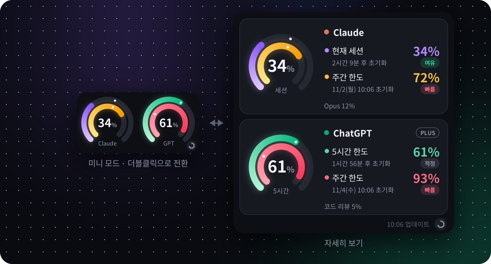
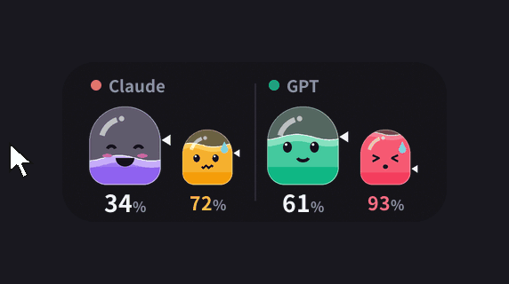
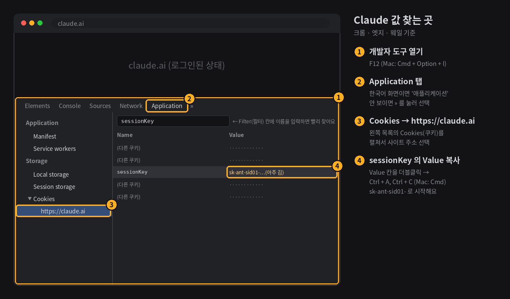
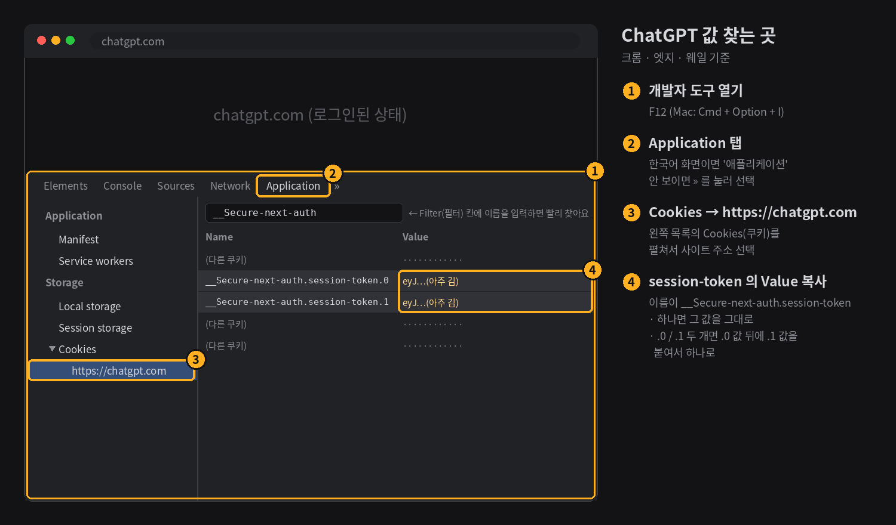
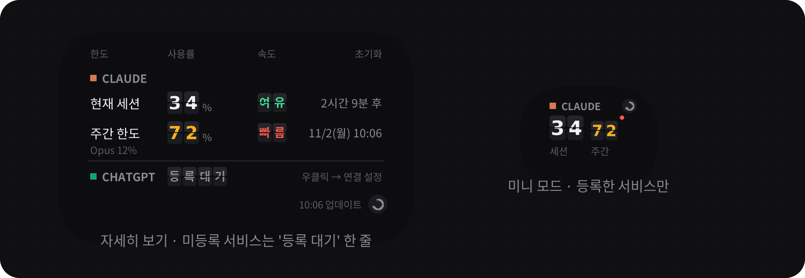
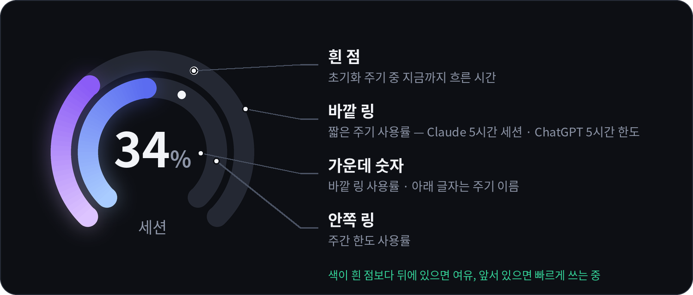

<div align="center">

# AI 사용량 위젯

**Claude와 ChatGPT(Codex) 사용량을 바탕화면과 아이폰에서 한눈에 확인합니다.**


[](LICENSE)



[빠른 시작](#빠른-시작) · [설치](#데스크톱-위젯-설치) · [등록하기](#등록하기) · [아이폰 위젯](#아이폰-위젯) · [화면 읽는 법](#화면-읽는-법) · [문제 해결](#문제-해결)

</div>

<br>

사용량 페이지에 매번 들어가지 않아도 됩니다. 공항 출발 안내판처럼 **숫자 카드가 착착 넘어가며** 지금 얼마나 썼는지, 이 속도로 써도 괜찮은지, 언제 초기화되는지를 보여 줍니다.

<p align="center">
  
</p>

> [!WARNING]
> Anthropic·OpenAI의 공식 앱이 아닙니다. 각 사이트의 사용량 페이지가 내부적으로 쓰는 주소를 불러오는 방식이므로,
> 사이트 구조가 바뀌면 갑자기 작동하지 않을 수 있습니다. 세션 키·토큰은 **로그인 정보와 같으니** 절대 공유하지 마십시오.

## 주요 기능

<table>
  <tr>
    <td width="33%" valign="top">
      <b>출발 안내판 스타일</b><br>
      <sub>숫자 카드가 한 장씩 넘어가며 바뀝니다. 불러오는 동안에는 숫자가 돌고, 클릭하면 한 번 섞였다가 제자리로 돌아옵니다.</sub>
    </td>
    <td width="33%" valign="top">
      <b>속도 표시</b><br>
      <sub>흐른 시간에 비해 <i>여유 · 적정 · 빠름</i> 을 글자 카드로 보여 줍니다. 미니 모드에서는 빠를 때만 작은 빨간 램프가 켜집니다.</sub>
    </td>
    <td width="33%" valign="top">
      <b>한도에 따라 바뀌는 색</b><br>
      <sub>숫자는 평소 흰색이고, 70%를 넘으면 주황, 90%를 넘으면 빨강으로 바뀝니다.</sub>
    </td>
  </tr>
  <tr>
    <td valign="top">
      <b>작은 크기</b><br>
      <sub>미니 모드는 약 180×66, 자세히 보기도 300×228 픽셀입니다. 작업 화면을 거의 가리지 않습니다.</sub>
    </td>
    <td valign="top">
      <b>투명도 조절</b><br>
      <sub>마우스 휠이나 메뉴로 30~100% 사이에서 조절합니다. 마우스를 올리면 잠시 선명해집니다.</sub>
    </td>
    <td valign="top">
      <b>항상 맨 앞</b><br>
      <sub>다른 '항상 위' 창이나 작업 표시줄에 밀려 뒤로 숨지 않도록 2초마다 다시 맨 앞으로 올라옵니다.</sub>
    </td>
  </tr>
  <tr>
    <td valign="top">
      <b>간편한 연결</b><br>
      <sub>Codex에 로그인해 둔 PC라면 ChatGPT는 따로 설정할 필요 없이 자동으로 연결됩니다.</sub>
    </td>
    <td valign="top">
      <b>자동 새로고침</b><br>
      <sub>사용량은 2분마다 새로고침되고, ↻ 버튼으로 바로 새로고침할 수도 있습니다.</sub>
    </td>
    <td valign="top">
      <b>아이폰 위젯</b><br>
      <sub>Scriptable 앱으로 홈 화면(작게·중간·크게)과 잠금 화면에 Claude 사용량을 띄웁니다.</sub>
    </td>
  </tr>
</table>

## 빠른 시작

Windows 기준입니다. 파이썬이 이미 설치되어 있다면 1분이면 충분합니다.

```bash
pip install pillow curl_cffi
```

1. [`desktop/llm_usage_widget.pyw`](desktop/llm_usage_widget.pyw)를 내려받아 더블클릭합니다.
2. Claude 세션 키를 붙여넣습니다. → [Claude 등록하기](#claude-등록하기)
3. ChatGPT는 Codex에 로그인되어 있으면 자동으로 연결됩니다. 아니면 쿠키 값을 붙여넣고, 쓰지 않으면 Cancel을 누릅니다. → [ChatGPT 등록하기](#chatgpt-등록하기)
4. 끝입니다. 다음부터는 **컴퓨터를 켜면 위젯이 자동으로 뜹니다.** → [자동 실행](#3-컴퓨터를-켤-때-자동-실행)

---

## 데스크톱 위젯 설치

> [!TIP]
> **파일 받는 법** — Git을 몰라도 괜찮습니다.
> - 파일 하나만: [`desktop/llm_usage_widget.pyw`](desktop/llm_usage_widget.pyw)를 열고 오른쪽 위 **⤓ (Download raw file)** 버튼을 누릅니다.
> - 전체: 이 페이지 위쪽의 초록색 **Code** 버튼 → **Download ZIP**을 누른 뒤 압축을 풉니다.

### 1. 파이썬과 패키지 설치

1. [python.org](https://www.python.org/downloads/)에서 파이썬을 설치합니다.
   - **Windows**: 설치 첫 화면에서 **"Add python.exe to PATH"** 를 반드시 체크합니다.
2. cmd(Windows) 또는 터미널(Mac)에서 패키지를 설치합니다.

   ```bash
   pip install pillow curl_cffi
   ```

   - Mac에서는 `pip` 대신 `pip3`를 사용합니다.
   - Mac에서 Homebrew로 파이썬을 설치했다면 `brew install python-tk`도 함께 실행합니다.

| 패키지 | 용도 |
|---|---|
| `pillow` | 숫자 카드 그리기 — **필수** |
| `curl_cffi` | 사이트의 자동 요청 차단 피하기 — ChatGPT는 사실상 필수 |

### 2. 실행

**Windows** — `llm_usage_widget.pyw`를 더블클릭하면 cmd 창 없이 위젯만 나타납니다.

```bat
:: cmd에서 실행하는 경우 ("pythonw"를 찾지 못하면 pyw로 바꿔 입력합니다)
pythonw llm_usage_widget.pyw
```

**Mac** — 터미널에서 파일이 있는 폴더로 이동한 뒤 실행합니다.

```bash
nohup python3 llm_usage_widget.pyw >/dev/null 2>&1 &
```

이후 터미널을 닫아도 위젯은 계속 떠 있습니다.

처음 실행하면 Claude 세션 키와 ChatGPT 토큰을 차례로 묻습니다. 값을 구하는 방법은 바로 아래 [등록하기](#등록하기)에 자세히 있습니다. **사용하지 않는 서비스는 Cancel**을 누르면 됩니다. 취소한 서비스는 미니 모드에 나타나지 않고, 자세히 보기에는 '등록 대기' 한 줄로만 표시됩니다.

> [!TIP]
> **업데이트**할 때는 위젯을 종료(우클릭 → 종료)한 뒤 새 `.pyw` 파일로 덮어쓰고 다시 실행하면 됩니다. 창 위치·세션 키 같은 설정은 홈 폴더의 설정 파일에 따로 저장되므로 그대로 유지됩니다.
>
> 예전 이름인 `claude_usage_widget.pyw` 를 쓰고 있었다면 새 파일 `llm_usage_widget.pyw` 를 받은 뒤 **옛 파일은 지우십시오.** 예전에 직접 만든 시작프로그램 바로가기나 Automator 앱도 이제 필요 없으니 함께 지웁니다. 설정 파일 이름(`.claude_usage_widget.json`)은 그대로라 세션 키와 창 위치는 이어집니다.

### 3. 컴퓨터를 켤 때 자동 실행

**따로 설정할 필요가 없습니다.** 위젯을 처음 실행하면 컴퓨터를 켤 때 자동으로 뜨도록 스스로 등록합니다. PC를 끄거나 다시 시작해도 로그인하면 위젯이 원래 자리에 다시 나타납니다.

- **끄기·켜기**: 위젯 우클릭 → **컴퓨터 켤 때 자동 실행**을 누릅니다. 체크 표시가 있으면 켜진 상태입니다.
- **파일을 옮겼다면**: 새 위치에서 한 번만 직접 실행하면 자동 실행도 새 위치로 바뀝니다.
- 위젯은 **한 번에 하나만** 뜹니다. 이미 떠 있을 때 파일을 다시 실행해도 창이 겹치지 않습니다.
- 압축(ZIP) 파일 안에서 바로 실행하면 등록하지 않습니다. 압축을 푼 뒤 실행하십시오.

<details>
<summary><b>어디에 등록되나요?</b></summary>

| OS | 등록 위치 | 확인하는 곳 |
|---|---|---|
| Windows | 레지스트리 `HKEY_CURRENT_USER\Software\Microsoft\Windows\CurrentVersion\Run` 의 `LLM Usage Widget` 값 | 설정 → 앱 → 시작 프로그램 (위젯 이름 대신 **Python**으로 보일 수 있습니다) |
| Mac | `~/Library/LaunchAgents/io.github.shun1403.llm-usage.plist` | 시스템 설정 → 일반 → 로그인 항목 → 백그라운드에서 허용 (**python3**으로 보일 수 있습니다) |

- 관리자 권한이 필요 없으며, 지금 로그인한 사용자에게만 적용됩니다.
- Mac은 처음 등록할 때 '백그라운드 항목 추가' 알림이 뜰 수 있습니다. 위젯이 등록한 항목이므로 그대로 두면 됩니다.

</details>

---

## 등록하기

위젯이 사용량을 가져오려면 각 서비스에 **로그인된 정보**가 필요합니다. 둘 중 하나만 등록해도 됩니다. ([하나만 쓰는 경우](#하나만-쓰는-경우))

| 서비스 | 필요한 것 | 구하는 곳 | 유효 기간 |
|---|---|---|---|
| **Claude** | 세션 키 (`sessionKey` 쿠키 값) | 브라우저 개발자 도구 | 몇 주 · claude.ai에서 로그아웃하면 바로 만료 |
| **ChatGPT** | Codex 로그인 **또는** 세션 토큰 (`__Secure-next-auth.session-token` 쿠키 값) | Codex 또는 브라우저 개발자 도구 | Codex 로그인은 Codex를 쓰면 자동 갱신 · 쿠키는 몇 주 |

> [!CAUTION]
> 세션 키·토큰은 **비밀번호와 같습니다.** 이 값만 있으면 누구나 내 계정에 로그인할 수 있습니다.
> - 메신저·이메일로 보내거나 스크린샷을 찍어 공유하지 마십시오. 화면 공유 중에는 개발자 도구를 열지 마십시오.
> - 위젯은 이 값을 **내 컴퓨터의 설정 파일에만** 저장하고, 사용량을 물어볼 때 claude.ai · chatgpt.com 에만 보냅니다.

---

### Claude 등록하기

<p align="center">
  
</p>

#### 1단계. 세션 키 복사하기

PC 브라우저에서 [claude.ai](https://claude.ai)에 로그인한 뒤(이미 로그인되어 있으면 그대로), **claude.ai 탭에서** 아래 순서대로 합니다.

<details open>
<summary><b>크롬 · 엣지 · 웨일</b></summary>

1. `F12` 를 누릅니다. (또는 `Ctrl + Shift + I`, Mac은 `Cmd + Option + I`) 화면 옆이나 아래에 개발자 도구가 열립니다.
2. 개발자 도구 위쪽 탭에서 **Application** 을 누릅니다. (한국어 화면이면 **애플리케이션**)
   - 탭이 안 보이면 탭 줄 오른쪽의 **»** 를 눌러 목록에서 고릅니다.
3. 왼쪽 목록에서 **Cookies**(쿠키) 왼쪽의 ▸ 를 눌러 펼친 뒤 **`https://claude.ai`** 를 누릅니다.
4. 오른쪽 표 위의 **Filter**(필터) 칸에 `sessionKey` 를 입력하면 한 줄만 남습니다.
5. **Name** 이 `sessionKey` 인 줄의 **Value** 칸을 더블클릭한 뒤 `Ctrl + A` → `Ctrl + C` 로 복사합니다. (Mac은 `Cmd`)
   - 줄을 한 번 클릭하면 아래쪽 **Cookie Value** 칸에도 전체 값이 보이니, 거기서 복사해도 됩니다.

</details>

<details>
<summary><b>파이어폭스</b></summary>

1. `F12` 를 누릅니다.
2. 위쪽 탭에서 **Storage**(저장소) 를 누릅니다.
3. 왼쪽 **Cookies**(쿠키) → **`https://claude.ai`** 를 누릅니다.
4. 이름이 `sessionKey` 인 줄의 **Value**(값) 칸을 더블클릭한 뒤 `Ctrl + A` → `Ctrl + C` 로 복사합니다.

</details>

<details>
<summary><b>사파리 (Mac)</b></summary>

1. 처음 한 번만: **Safari → 설정 → 고급** 에서 **웹 개발자용 기능 보기**를 켭니다. (버전에 따라 "메뉴 막대에서 개발자용 메뉴 보기")
2. claude.ai 탭에서 `Cmd + Option + I` 를 누릅니다.
3. 위쪽 탭에서 **저장 공간**(Storage) → **쿠키** → **claude.ai** 를 누릅니다.
4. 이름이 `sessionKey` 인 줄의 값을 더블클릭한 뒤 `Cmd + A` → `Cmd + C` 로 복사합니다.

</details>

> [!TIP]
> 제대로 복사했다면 `sk-ant-sid01-` 로 시작하는 **긴 문자열**입니다. 앞뒤에 공백이 붙어도 괜찮습니다.

#### 2단계. 위젯에 붙여넣기

- **처음 실행할 때**: "Claude 세션 키" 창이 뜨면 `Ctrl + V` 로 붙여넣고 **OK** 를 누릅니다. 입력한 값은 `•••` 로 가려져 보입니다.
- **이미 실행 중일 때**: 위젯을 우클릭 → **Claude 세션 키 변경** → 붙여넣기 → **OK**.

#### 3단계. 됐는지 확인하기

- 몇 초 안에 숫자 카드가 넘어가며 사용률이 보이면 성공입니다.
- **"Claude 세션 키가 만료됐어요"** 가 보이면 값이 잘못 복사됐거나 만료된 것입니다. 1단계부터 다시 합니다.
- **"요청이 차단됐어요"** 가 보이면 `pip install curl_cffi` 를 실행한 뒤 위젯을 다시 켭니다.

#### 알아 두기

- **claude.ai에서 로그아웃하면 세션 키가 바로 만료됩니다.** 키를 복사한 브라우저에서는 로그아웃하지 말고 탭만 닫으십시오.
- 로그아웃하지 않아도 몇 주가 지나면 만료됩니다. 그때는 같은 방법으로 새 값을 넣으면 됩니다.
- 개인 계정과 회사(Team · Enterprise) 계정처럼 조직이 여러 개면, 채팅을 쓸 수 있는 첫 번째 조직의 사용량이 표시됩니다.
- [아이폰 위젯](#아이폰-위젯)에도 같은 세션 키를 넣으면 됩니다.

---

### ChatGPT 등록하기

> [!NOTE]
> ChatGPT 쪽 수치는 [chatgpt.com/codex/settings/usage](https://chatgpt.com/codex/settings/usage)에 나오는 **Codex 사용 한도**입니다.
> 일반 ChatGPT 채팅의 메시지 한도는 OpenAI가 퍼센트로 공개하지 않아 가져올 수 없습니다. Codex 한도가 없는 요금제라면 "ChatGPT 사용량 항목이 없어요"라고 표시됩니다.

두 방법 중 하나만 하면 됩니다.

| | 방법 A. Codex 로그인 (추천) | 방법 B. 브라우저 쿠키 복사 |
|---|---|---|
| **이런 분께** | Codex(CLI · VS Code 확장 · 앱)를 쓰는 분 | Codex를 쓰지 않는 분 |
| **할 일** | Codex에 ChatGPT 계정으로 한 번 로그인 | 개발자 도구에서 값을 복사해 붙여넣기 |
| **만료되면** | Codex를 한 번 실행하면 자동 갱신 | 같은 방법으로 다시 복사 |

<sub>둘 다 해 두면 Codex 로그인을 먼저 쓰고, 안 되면 쿠키를 씁니다.</sub>

#### 방법 A. Codex 로그인 (추천)

1. **Codex 설치** — 이미 쓰고 있다면 건너뜁니다.
   - 터미널용(CLI): [Node.js](https://nodejs.org)를 설치한 뒤 cmd · 터미널에서 실행합니다.

     ```bash
     npm install -g @openai/codex
     ```

   - VS Code 확장이나 Codex 앱을 써도 됩니다. 설치 방법은 [openai/codex](https://github.com/openai/codex)를 참고하십시오.
2. **로그인** — cmd · 터미널에서 `codex` 를 실행하고 **Sign in with ChatGPT** 를 고릅니다. 브라우저가 열리면 ChatGPT 계정으로 로그인합니다.
   - **API 키로 로그인하면 안 됩니다.** 그러면 위젯에 "Codex가 ChatGPT 계정으로 로그인되어 있지 않아요"라고 표시됩니다.
3. **로그인 파일 확인** — 로그인이 끝나면 아래 파일이 생깁니다. 위젯은 이 파일을 **읽기만** 하며 절대 수정하지 않습니다.

   | OS | 위치 |
   |---|---|
   | Windows | `C:\Users\사용자이름\.codex\auth.json` |
   | Mac | `~/.codex/auth.json` |

   <sub>환경 변수 `CODEX_HOME` 을 설정해 두었다면 그 폴더의 `auth.json` 을 읽습니다.</sub>
4. **위젯에서 확인** — 따로 입력할 것은 없습니다. 위젯이 이미 켜져 있다면 우클릭 → **지금 새로고침**을 누르거나 2분 정도 기다리면 ChatGPT 사용량이 나타납니다.
   - Codex에 로그인한 뒤 위젯을 처음 실행하면 ChatGPT는 자동으로 연결되므로 Claude 세션 키도 묻지 않습니다. Claude도 쓰려면 우클릭 → **Claude 세션 키 변경**으로 넣습니다.
   - **"Codex 로그인이 만료됐어요"** 가 보이면 cmd · 터미널에서 `codex` 를 한 번 실행하거나 VS Code의 Codex 확장을 열면 자동으로 갱신됩니다.

#### 방법 B. 브라우저 쿠키 복사

<p align="center">
  
</p>

1. PC 브라우저에서 [chatgpt.com](https://chatgpt.com)에 로그인합니다.
2. **chatgpt.com 탭에서** 개발자 도구를 열고 쿠키 목록으로 갑니다. 순서는 [Claude 1단계](#1단계-세션-키-복사하기)와 같고, 사이트 주소만 **`https://chatgpt.com`** 입니다.
3. **Filter**(필터) 칸에 `session-token` 을 입력합니다.
4. 보이는 쿠키 모양에 따라 값을 복사합니다.
   - **`__Secure-next-auth.session-token` 하나만 있을 때** → 그 줄의 **Value** 를 그대로 복사합니다.
   - **끝에 `.0`, `.1` 이 붙은 두 줄이 있을 때** (값이 너무 길어 둘로 나뉜 경우)
     1. `.0` 줄의 Value를 복사해 메모장에 붙여넣습니다.
     2. `.1` 줄의 Value를 복사해 메모장의 **바로 뒤에, 띄어쓰기나 줄바꿈 없이** 붙여넣습니다.
     3. 메모장의 전체 내용을 복사합니다.
5. 위젯을 우클릭 → **ChatGPT 연결 설정** → 붙여넣기 → **OK**. (처음 실행할 때는 "ChatGPT 연결" 창에 붙여넣습니다.)
6. 몇 초 안에 ChatGPT 숫자가 보이면 성공입니다.
   - **"ChatGPT 세션 토큰이 만료됐어요"** 가 보이면 값이 잘못 복사됐거나 만료된 것입니다. 1번부터 다시 합니다.
   - **"요청이 차단됐어요"** 가 보이면 `pip install curl_cffi` 를 실행한 뒤 위젯을 다시 켭니다. ChatGPT는 이 패키지가 거의 필수입니다.

> [!TIP]
> 토큰은 `eyJ` 로 시작하는 **아주 긴 문자열**(수천 자)입니다. 끝까지 다 복사됐는지 확인하십시오.
> chatgpt.com에서 로그아웃해도 토큰이 만료되니, 복사한 브라우저에서는 로그아웃하지 마십시오.

---

### 등록 정보 바꾸기 · 지우기

| 하고 싶은 것 | 방법 |
|---|---|
| **새 값으로 바꾸기** | 우클릭 → **Claude 세션 키 변경** / **ChatGPT 연결 설정** 에서 새 값을 붙여넣습니다. |
| **화면에서만 숨기기** | 우클릭 → **Claude 표시** / **ChatGPT 표시** 를 끕니다. 등록 정보는 남아 있습니다. |
| **등록 정보 지우기** | 위젯을 종료한 뒤 [설정 파일](#설정-파일)을 메모장으로 엽니다. Claude는 `"session_key"`, ChatGPT 쿠키는 `"gpt_session_token"` 과 `"gpt_token_cache"` 항목(`{ }` 로 묶인 여러 줄 포함)을 지우고 저장합니다. 마지막 항목을 지웠다면 바로 앞 줄 끝의 쉼표(`,`)도 지웁니다. 잘못 고치면 설정이 초기화되어 처음 실행처럼 키를 다시 묻습니다. 모두 지우려면 설정 파일을 통째로 삭제해도 됩니다. |
| **Codex 로그인 연결 끊기** | Codex에서 로그아웃합니다. (`~/.codex/auth.json` 이 없어지면 위젯도 더 이상 쓰지 않습니다.) |


---

## 아이폰 위젯

[Scriptable](https://scriptable.app) 앱을 이용한 홈 화면·잠금 화면 위젯입니다. **현재는 Claude 사용량만** 지원합니다.

### 설치

1. App Store에서 **Scriptable**을 설치합니다. (무료)
2. [`ios/claude_usage_scriptable.js`](ios/claude_usage_scriptable.js) 파일을 열고 **Copy raw file** 버튼(또는 **Raw** 화면에서 전체 선택)으로 내용 전체를 복사합니다.
3. Scriptable 앱 → 오른쪽 위 **＋** → 붙여넣기를 한 뒤, 위쪽 제목을 `Claude 사용량`처럼 알아보기 쉽게 바꾸고 완료를 누릅니다.
4. 방금 만든 스크립트를 눌러 실행하고 **세션 키를 입력**합니다. ([세션 키 구하는 법](#claude-등록하기))
   - PC에서 복사한 값은 범용 클립보드·AirDrop처럼 **본인 기기끼리만** 옮기십시오. 메신저로 보내지 마십시오.
   - 세션 키는 아이폰 **키체인**에만 저장됩니다.
5. 위젯을 추가합니다.
   - **홈 화면**: 빈 곳을 길게 누름 → 편집 → 위젯 추가(iOS 17 이하는 왼쪽 위 ＋) → Scriptable → 크기 선택 → 추가된 위젯을 길게 눌러 **위젯 편집** → Script에서 방금 만든 스크립트를 선택합니다.
   - **잠금 화면**: 잠금 화면을 길게 누름 → 사용자화 → 잠금 화면 → 위젯 영역 → Scriptable 추가 → 같은 방법으로 스크립트를 선택합니다.

### 위젯 종류

| 위치 | 크기 | 표시 내용 |
|---|---|---|
| 홈 화면 | 작게 · 중간 | 현재 세션 + 주간(전체) 막대 그래프, 초기화까지 남은 시간 |
| 홈 화면 | 크게 | 위 내용 + 주간 Opus / Sonnet 한도(있는 경우) |
| 잠금 화면 | 직사각형 | `세션 34% · 2h9m` / `주간 72% · 월 10:06` |
| 잠금 화면 | 한 줄 (시계 위) | `Claude 세션 34% · 주간 72%` |

- 홈 화면 위젯을 누르면 claude.ai 사용량 페이지가 열립니다.
- 막대 색은 70% 이상이면 주황, 90% 이상이면 빨강으로 바뀝니다.
- 스크립트를 앱에서 다시 실행하면 **미리보기 / 세션 키 변경 / 세션 키 삭제** 메뉴가 나타납니다.
- iOS 정책상 위젯은 보통 **15분 이상 간격**으로만 새로고침됩니다.

---

## 사용법

| 동작 | 기능 |
|---|---|
| 드래그 | 창 이동 (위치는 자동 저장) |
| 클릭 | 그 서비스의 숫자 카드가 한 번 섞였다가 제자리로 돌아옵니다 |
| 더블클릭 | 미니 모드 ↔ 자세히 보기 전환 |
| 마우스 휠 | 투명도 조절 (위로 굴리면 선명하게, 아래로 굴리면 투명하게) |
| 마우스 올리기 | 잠시 100% 선명하게 보입니다 |
| ↻ 버튼 | 두 서비스 모두 즉시 새로고침 (미니 모드에서는 마우스를 올리면 나타남) |
| 우클릭 (Mac: `Control` + 클릭) | 메뉴 열기 |

<details>
<summary><b>우클릭 메뉴 항목</b></summary>

- 지금 새로고침
- 미니 / 자세히 보기
- 항상 위에 표시 켜기·끄기
- 컴퓨터 켤 때 자동 실행 켜기·끄기
- 투명도 — 100% ~ 30%, 마우스를 올리면 선명하게 켜기·끄기
- Claude 표시 / ChatGPT 표시 켜기·끄기
- Claude 세션 키 변경
- ChatGPT 연결 설정
- 종료

</details>

사용량은 **2분마다** 자동으로 새로고침됩니다. 인터넷 연결 오류가 나면 15초 뒤에 다시 시도하므로, 컴퓨터를 막 켰을 때 잠깐 오류가 보여도 곧 정상으로 돌아옵니다. 한 서비스에서 오류가 나더라도 다른 서비스는 정상적으로 표시됩니다.

### 투명도 설정

| 방법 | 하는 법 |
|---|---|
| **마우스 휠** | 위젯 위에서 휠을 굴립니다. 위로 굴리면 선명하게, 아래로 굴리면 투명하게 (10%씩, 30~100%) |
| **메뉴** | 우클릭 → **투명도** → 100% ~ 30% 중 선택 |

> [!TIP]
> 기본적으로 **마우스를 올리면 잠시 100% 선명하게** 보입니다. 그래서 위젯 위에 마우스가 있을 때는 투명도를 낮춰도 그대로인 것처럼 보일 수 있습니다. 마우스를 위젯 밖으로 빼면 설정한 투명도로 돌아갑니다.
> 항상 같은 투명도로 보고 싶다면 우클릭 → 투명도 → **마우스를 올리면 선명하게**를 끕니다. 설정은 자동으로 저장됩니다.

### 하나만 쓰는 경우

Claude와 ChatGPT 중 하나만 등록해도 됩니다.

- **미니 모드**에는 등록한 서비스만 나타납니다.
- **자세히 보기**에는 등록하지 않은 서비스가 `등록 대기` 한 줄로만 표시되어 자리를 거의 차지하지 않습니다.
- 나중에 등록하려면 우클릭 → **Claude 세션 키 변경** 또는 **ChatGPT 연결 설정**을 선택합니다. 아예 숨기려면 우클릭 → **Claude 표시** / **ChatGPT 표시**를 끕니다.

<p align="center">
  
</p>

## 화면 읽는 법

<p align="center">
  
</p>

| 서비스 | 첫 줄 | 둘째 줄 |
|---|---|---|
| Claude | 현재 세션 (5시간) | 주간 한도 |
| ChatGPT | 5시간 한도 | 주간 한도 |

<sub>ChatGPT는 요금제에 따라 주간 한도 한 줄만 나올 수 있습니다. 미니 모드에서는 왼쪽 큰 카드가 첫 줄, 오른쪽 작은 카드가 둘째 줄입니다.</sub>

| 칸 | 뜻 |
|---|---|
| **사용률** | 숫자 카드. 평소 흰색, 70% 이상 주황, 90% 이상 빨강 |
| **속도** | 리셋 주기 중 흐른 시간에 비해 얼마나 빨리 쓰는지 (주기가 10% 이상 지난 뒤부터 표시) |
| **초기화** | 하루 안이면 남은 시간, 그보다 멀면 초기화 날짜와 시각 |

| 속도 카드 | 의미 |
|---|---|
| 🟢 **여유** | 시간에 비해 천천히 쓰는 중입니다 |
| ⚪ **적정** | 시간 흐름과 비슷한 속도로 쓰는 중입니다 |
| 🔴 **빠름** | 이대로라면 초기화 전에 한도에 닿을 수 있습니다 (미니 모드에서는 빨간 램프) |

- 숫자 카드에 빨간 `--` 가 보이면 오류(세션 키 만료 등)입니다. 이유는 자세히 보기에 표시됩니다. 등록하지 않은 서비스는 `등록 대기`로 표시됩니다.
- 서비스 이름 오른쪽에는 요금제(`PLUS` 등)가, 맨 아래 작은 글씨에는 Opus / Sonnet 별도 한도(Claude)와 코드 리뷰 한도(ChatGPT)가 있는 경우 함께 표시됩니다.

---

## 문제 해결

<details>
<summary><b>위젯이 아예 뜨지 않습니다</b></summary>

`pythonw`는 오류를 보여 주지 않습니다. cmd에서 아래처럼 실행해 오류 메시지를 확인하십시오.

```bat
python llm_usage_widget.pyw
```

가장 흔한 원인은 `pip install pillow`를 하지 않은 경우입니다.

위젯은 한 번에 하나만 뜨므로, 이미 실행 중이면 다시 실행해도 아무 일도 일어나지 않습니다. 화면에 보이지 않는다면 작업 관리자(Mac: 활성 상태 보기)에서 `pythonw` / `python` 을 종료한 뒤 다시 실행하십시오.

</details>

<details>
<summary><b>컴퓨터를 켜도 위젯이 뜨지 않습니다</b></summary>

1. 위젯 우클릭 → **컴퓨터 켤 때 자동 실행**에 체크 표시가 있는지 확인합니다.
2. 위젯 파일을 옮겼거나 파이썬을 다시 설치·업데이트했다면 위젯을 한 번 직접 실행합니다. 자동 실행이 새 경로로 다시 등록됩니다.
3. **Windows**: 설정 → 앱 → 시작 프로그램에서 **Python** 항목이 꺼져 있지 않은지 확인합니다.
4. **Mac**: 시스템 설정 → 일반 → 로그인 항목 → 백그라운드에서 허용에서 **python3** 항목이 꺼져 있지 않은지 확인합니다.

</details>

<details>
<summary><b>"Claude 세션 키가 만료됐어요"라고 나옵니다</b></summary>

세션 키는 몇 주가 지나면 만료되며, claude.ai에서 로그아웃해도 만료됩니다.
[Claude 등록하기](#claude-등록하기) 방법으로 새 값을 복사한 뒤 **우클릭 → Claude 세션 키 변경**을 선택합니다.

</details>

<details>
<summary><b>"Codex 로그인이 만료됐어요"라고 나옵니다</b></summary>

cmd나 터미널에서 `codex`를 한 번 실행하거나 VS Code의 Codex 확장을 열면 자동으로 갱신됩니다.
또는 [방법 B (쿠키)](#방법-b-브라우저-쿠키-복사)로 연결합니다.

</details>

<details>
<summary><b>"ChatGPT 세션 토큰이 만료됐어요"라고 나옵니다</b></summary>

[방법 B](#방법-b-브라우저-쿠키-복사)로 새 값을 복사한 뒤 **우클릭 → ChatGPT 연결 설정**을 선택합니다.

</details>

<details>
<summary><b>'등록 대기'라고 표시됩니다</b></summary>

그 서비스의 세션 키·토큰이 없다는 뜻입니다. **우클릭 → Claude 세션 키 변경** 또는 **ChatGPT 연결 설정**에서 값을 넣거나, 쓰지 않는다면 **우클릭 → Claude 표시 / ChatGPT 표시**를 끕니다.
ChatGPT는 이 컴퓨터에서 Codex에 로그인하면 다음 새로고침 때 자동으로 연결됩니다.

</details>

<details>
<summary><b>"요청이 차단됐어요"라고 나옵니다</b></summary>

```bash
pip install curl_cffi
```

설치한 뒤 위젯을 다시 실행합니다. 특히 ChatGPT는 거의 필수입니다.

</details>

<details>
<summary><b>위젯이 다른 창 뒤로 숨습니다</b></summary>

우클릭 메뉴에서 **항상 위에 표시**가 켜져 있는지 확인합니다. 켜져 있으면 위젯이 2초마다 스스로 맨 앞으로 다시 올라옵니다.
전체 화면 게임처럼 화면을 독점하는 프로그램 위에는 표시되지 않을 수 있습니다.

</details>

<details>
<summary><b>창이 멈췄습니다 / 응답 없음</b></summary>

작업 관리자(`Ctrl + Shift + Esc`)에서 `pythonw.exe` 또는 `python.exe`를 종료한 뒤 다시 실행합니다.

</details>

<details>
<summary><b>창이 화면 밖으로 사라졌습니다</b></summary>

[설정 파일](#설정-파일)을 메모장으로 열어 `"x"`, `"y"` 값을 `40`으로 바꾼 뒤 다시 실행합니다.

</details>

---

## 설정 파일

| OS | 위치 |
|---|---|
| Windows | `C:\Users\사용자이름\.claude_usage_widget.json` |
| Mac | `~/.claude_usage_widget.json` |

- **저장되는 항목**: Claude 세션 키, ChatGPT 세션 토큰, 창 위치, 미니 모드 여부, 항상 위 여부, 투명도, 마우스를 올리면 선명하게 여부, 서비스별 표시 여부, 자동 실행 여부
- Mac은 위젯이 두 개 뜨지 않도록 빈 파일 `~/.llm_usage_widget.lock` 도 함께 만듭니다.
- Codex 로그인 정보(`~/.codex/auth.json`)는 읽기만 하며 절대 수정하지 않습니다.
- **새로고침 간격**을 바꾸려면 `llm_usage_widget.pyw` 위쪽의 `REFRESH_SEC = 120` 숫자(초)를 수정합니다. 너무 짧으면 차단될 수 있으므로 **60 이상**을 권장합니다.

> [!CAUTION]
> 설정 파일에는 세션 키·토큰이 그대로 들어 있습니다. 다른 사람에게 보내거나 GitHub 등에 올리지 마십시오.

## 삭제하기

1. 위젯에서 우클릭 → **컴퓨터 켤 때 자동 실행**을 끈 다음, 우클릭 → 종료를 선택합니다.
2. 위젯 파일을 삭제합니다.
3. 위의 설정 파일을 삭제합니다. (세션 키·토큰도 함께 지워집니다.) Mac은 `~/.llm_usage_widget.lock` 도 지웁니다.
4. 1번에서 자동 실행을 끄지 않고 파일부터 지웠다면, 아래 명령으로 자동 실행 등록을 지웁니다.
   - Windows (cmd): `reg delete HKCU\Software\Microsoft\Windows\CurrentVersion\Run /v "LLM Usage Widget" /f`
   - Mac (터미널): `rm ~/Library/LaunchAgents/io.github.shun1403.llm-usage.plist`
5. 아이폰은 스크립트를 실행해 **세션 키 삭제**를 선택한 뒤, 위젯과 스크립트를 삭제합니다.

## 폴더 구조

```
llm-usage/
├── desktop/
│   └── llm_usage_widget.pyw     # Windows / Mac 데스크톱 위젯 (Claude + ChatGPT)
├── ios/
│   └── claude_usage_scriptable.js  # 아이폰 Scriptable 위젯 (Claude)
├── docs/
│   ├── images/                     # README 이미지·스크린샷
│   └── 작업정리.md                  # 개발 과정 기록
├── requirements.txt                # 데스크톱 위젯 필요 패키지
├── LICENSE                         # MIT 라이선스
└── README.md
```

첫 막대 그래프부터 네온 링, 막대 대시보드, 젤리 캐릭터를 거쳐 지금의 스플릿 플랩에 이르기까지의 개발 과정은 [docs/작업정리.md](docs/작업정리.md)에 정리되어 있습니다.

## 알려진 한계

- 공식 API가 아니라 각 사이트 사용량 페이지의 내부 주소를 쓰는 방식이므로, 사이트 구조가 바뀌면 작동이 멈출 수 있습니다.
- 세션 키·토큰은 몇 주가 지나면 만료되어 다시 입력해야 합니다.
- 아이폰 위젯은 아직 Claude만 지원합니다.
- 실제 계정 대신 가짜 응답 데이터로 화면과 동작을 확인한 상태입니다. 이상한 점이 있으면 [이슈](https://github.com/shun1403/llm-usage/issues)로 알려 주십시오.
- 정확한 사용량은 언제나 각 사이트에서 확인할 수 있습니다.
  - Claude: claude.ai → 설정 → 사용량
  - ChatGPT: [chatgpt.com/codex/settings/usage](https://chatgpt.com/codex/settings/usage)

## 라이선스

[MIT 라이선스](LICENSE)입니다. 개인·회사 상관없이 자유롭게 쓰고, 고치고, 다시 배포할 수 있습니다. 다시 배포할 때는 저작권 표시와 라이선스 문구를 함께 넣어 주십시오.
이 소프트웨어는 있는 그대로 제공되며, 사용으로 생긴 문제(계정 제한 등)에 대해 책임지지 않습니다.

---

<div align="center">
<sub>이 프로젝트는 Anthropic, OpenAI와 관련이 없는 개인 프로젝트입니다.<br>Claude는 Anthropic의, ChatGPT·Codex는 OpenAI의 상표입니다.</sub>
</div>
